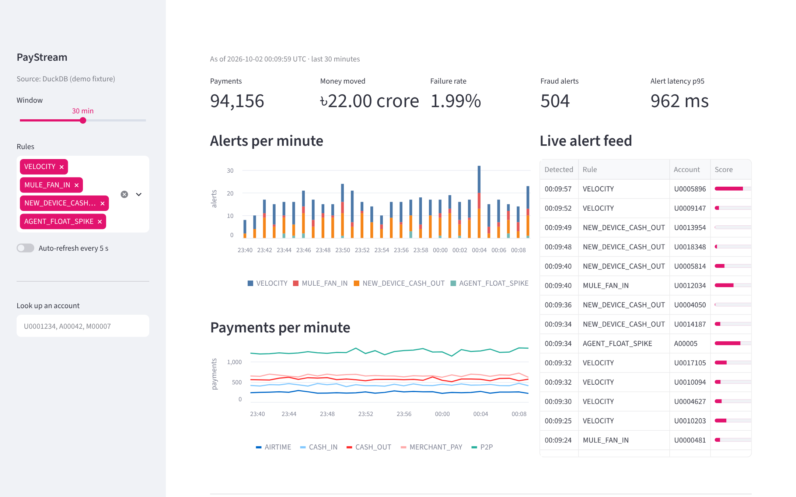
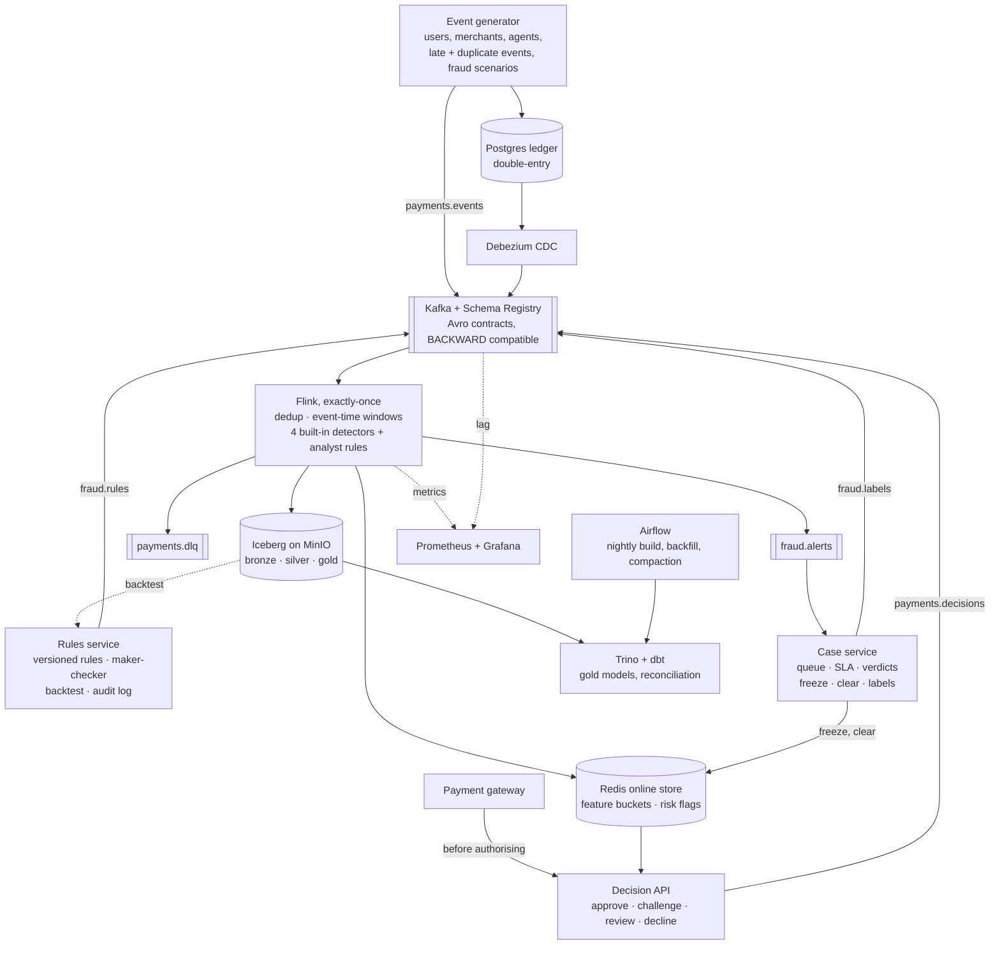
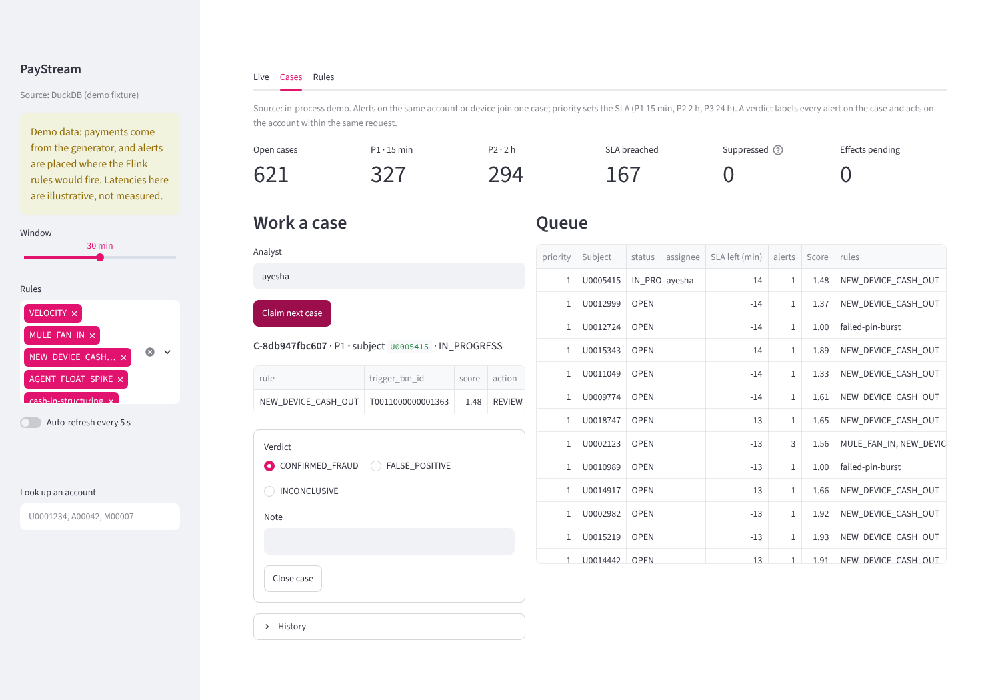

# PayStream

A real-time data platform for a mobile financial service (bKash-style payments: P2P transfers,
cash-in and cash-out at agents, merchant payments, airtime). It ingests payment events and ledger
changes, detects fraud within seconds, keeps an exactly-once lakehouse, and reconciles the stream
against the ledger to the paisa.

Everything runs on a laptop with Docker Compose.


<sub>The Fraud Ops Console in demo mode (`make demo`, no Docker needed). On the live stack it reads the lakehouse through Trino and refreshes every 5 s.</sub>



## What it shows

| Problem | How PayStream handles it | Where |
| --- | --- | --- |
| Duplicates from app retries | Keyed dedup on `txn_id` with state TTL, then a second dedup in dbt for anything older | [`Dedup`](flink-jobs/src/main/java/io/paystream/flink/pipeline/Dedup.java), [`stg_payments`](dbt/models/staging/stg_payments.sql) |
| Late, out-of-order events | Event-time watermarks (10 s bound); late events still reach silver and are counted on the right day by the batch layer | [`PaymentsPipeline`](flink-jobs/src/main/java/io/paystream/flink/pipeline/PaymentsPipeline.java) |
| No loss, no double counting on failure | Flink checkpoints + Iceberg commit-on-checkpoint; verified by killing the TaskManager and broker mid-run | [`IcebergTables`](flink-jobs/src/main/java/io/paystream/flink/sink/IcebergTables.java), [`chaos.sh`](scripts/chaos.sh) |
| Schema changes | Avro in Schema Registry with BACKWARD compatibility; v1 producers keep working after v2 adds `channel` | [`schemas/`](schemas), [`SerdeTest`](flink-jobs/src/test/java/io/paystream/flink/serde/SerdeTest.java) |
| Bad records | Undecodable records go to a dead-letter topic with offset and error; the job keeps running | [`PaymentEventDeserializer`](flink-jobs/src/main/java/io/paystream/flink/serde/PaymentEventDeserializer.java) |
| Fraud in seconds | Four keyed detectors fire on arrival, not on watermark: velocity, mule fan-in, new-device cash-out, agent float spike vs the agent's own baseline | [`rules/`](flink-jobs/src/main/java/io/paystream/flink/rules) |
| New fraud patterns without a deploy | Analysts write rules as JSON; Flink loads them through broadcast state and changes behaviour mid-stream, keeping state across restarts. New rules run in shadow first | [`DynamicRuleEvaluator`](flink-jobs/src/main/java/io/paystream/flink/rules/dynamic/DynamicRuleEvaluator.java), [`rules/library`](rules/library) |
| Stopping fraud before money moves | The gateway asks the decision API before authorising. One pipelined Redis read of the feature buckets and risk flags Flink maintains; limits, flags from streaming rules, step-up on new devices, shared devices, mule fan-in; fails open only for small amounts when Redis is slow | [`decision-service/`](decision-service/src/paystream_decision/policy.py), [`OnlineFeatures`](flink-jobs/src/main/java/io/paystream/flink/online/OnlineFeatures.java), [ADR 8](docs/adr/0008-inline-decisions-from-streaming-state.md) |
| Training data without skew | Every decision is logged with the exact features it used and lands in `silver.decisions`; the model trains on that log joined to case labels, never on recomputed features | [`log.py`](decision-service/src/paystream_decision/log.py), [`dataset.py`](ml/src/paystream_ml/dataset.py) |
| A model in the payment path | LightGBM exported to a JSON tree format the decision service scores in pure Python (~120 µs), checked equal to LightGBM to 1e-9. Champion acts, challenger is scored on the same traffic and logged; promotion needs a paired-bootstrap win on fresh labelled decisions; daily drift check | [`ml/`](ml/src/paystream_ml/registry.py), [`model.py`](decision-service/src/paystream_decision/model.py), [ADR 10](docs/adr/0010-model-trained-on-the-decision-log.md) |
| Closing the loop | Alerts and held payments become cases, one per account or device, prioritised with SLAs. A verdict labels every alert on the case and freezes the account or lifts its flags within the request; effects go through a transactional outbox, and Redis can be rebuilt from Postgres | [`case-service/`](case-service/src/paystream_cases/store.py), [ADR 9](docs/adr/0009-cases-close-the-loop.md) |
| Regulatory reporting | Cash Transaction Reports and an STR worklist built in dbt per customer and Dhaka business day; structuring, pass-through and fan-in typologies; thresholds as config; dbt unit tests pin each rule; shareable extracts use salted pseudonyms | [`dbt/models/aml`](dbt/models/aml), [ADR 11](docs/adr/0011-aml-reporting-in-the-lakehouse.md) |
| Running it for real | Kubernetes with operators: Strimzi Kafka (KRaft, TLS + SCRAM, an ACL per service), Flink jobs upgraded through savepoints with HA and autoscaling, a Helm chart for the services with default-deny network policies; Terraform for AWS (EKS over three zones, S3 under KMS, RDS, ElastiCache with TLS, an IAM role per service account). Schema-checked and validated in CI | [`deploy/`](deploy/README.md), [ADR 12](docs/adr/0012-production-on-kubernetes-with-operators.md) |
| Rule governance | Versioned rules, backtest on lakehouse history, four-eyes approval, kill switch, hash-chained audit log | [`rules-service/`](rules-service/src/paystream_rules/store.py), [ADR 7](docs/adr/0007-analyst-rules-without-deploys.md) |
| Backtest = production | The Python backtester and the Flink evaluator run the same conformance vectors in CI | [`rules/conformance`](rules/conformance) |
| Money correctness | Integer paisa everywhere; double-entry ledger with a deferred balance check; daily stream vs ledger reconciliation | [`ledger/`](ledger/001_schema.sql), [`recon_stream_vs_ledger`](dbt/models/marts/recon_stream_vs_ledger.sql) |
| Reprocessing | Bronze keeps every record as received; Airflow rebuilds a day of silver from bronze, then gold | [`paystream_backfill`](airflow/dags/paystream_backfill.py) |
| Operating it | Grafana: throughput, consumer lag, alert latency, checkpoints, watermark lag | [`monitoring/`](monitoring) |
| Acting on it | Fraud Ops Console: live alert feed, the case queue with claim and close, AML worklist, alerts and payments per minute, rule performance, reconciliation status, agents low on float, account lookup | [`dashboard/`](dashboard/app.py) |


<sub>The Cases tab: the analyst claims the most urgent case and closes it with a verdict. In the demo the real case store runs in process on the fixture's alerts.</sub>

Design and tradeoffs: [docs/design.md](docs/design.md) and the [ADRs](docs/adr).

## Run it

Needs Docker with about 10 GB of memory for the stack, Java 17 and Python 3.11+ for tests.

Just want to see it? `make demo` builds a demo dataset with the real generator and dbt models and
opens the console at http://localhost:8501, with no Docker.

```bash
make up          # starts the stack, creates topics, registers the CDC connector, submits both Flink jobs
make load        # 1,000 payments/s for 10 minutes into Kafka and the ledger
make sql         # Trino: SELECT * FROM silver.fraud_alerts ORDER BY detected_at DESC LIMIT 20;
make console     # Fraud Ops Console on the live stack: http://localhost:8501
make rules-demo  # draft, backtest, approve and publish a rule; Flink runs it within seconds
make decide-load # open-loop load test of the decision API (RPS=1000 DURATION=60)
make up-batch    # Airflow at http://localhost:8088 (nightly dbt build, backfill, model training and drift)
make model       # train a challenger on the lakehouse, promote it if it beats the champion
make bench       # RATE=5000 DURATION=1800, writes benchmarks/runs/<time>.json
make bench CHAOS=1
make down
```

UIs: Flink http://localhost:8082 · Grafana http://localhost:3000 · MinIO http://localhost:9001 ·
Rules API http://localhost:8090/docs · Decision API http://localhost:8095/docs ·
Case API http://localhost:8097/docs.

**Production.** [`deploy/`](deploy/README.md) has the Kubernetes and AWS version with an install
runbook: Terraform for the cloud, Strimzi and Flink operator manifests, and a Helm chart.
`make deploy-check` validates all three; it has not yet been applied to a real AWS account.

## Tests

`make test` runs all of them; CI runs the same on every push.

* **Generator** (pytest): reproducibility, rate, late and duplicate injection, fraud scenario shape,
  Avro contract validity for v1 and v2, and that a v2 reader reads v1 data.
* **Flink** (JUnit, Flink test harness): each rule against real keyed state, timers and watermarks;
  analyst rules hot-swapped mid-stream, versions never rolling back, history freed when a rule is
  disabled, and rules plus history surviving a restore from checkpoint;
  dedup surviving a snapshot and restore; Avro decoding, schema evolution and DLQ routing; and an
  end-to-end run of the whole job graph into a real Iceberg catalog on local disk.
* **Rules service** (pytest): draft, submit, approve and reject; the author cannot approve; a failed
  publish leaves nothing live; the kill switch; tampering with the audit log is detected; the HTTP API
  with roles; and the conformance vectors, which the Flink tests also run.
* **Case service** (pytest, against a real Redis in CI): alerts on one subject share a case, replays
  are ignored, escalation tightens the SLA, two analysts never claim the same case, verdicts produce
  labels, a freeze is enforced by the decision service, a false positive lifts flags and suppresses the
  rule, effects retry in order after a failure, and Redis is rebuilt from Postgres after losing everything.
* **Decision service** (pytest): feature windows evaluated at decision time, limits, flags and their
  expiry, step-up on new devices, degraded mode under a slow store, and the decision-log contract
  that Flink parses (also tested on the Java side). The Redis sink is tested against a real Redis.
* **Model** (pytest, plus the full lifecycle on the fixture in CI): the served evaluator equals
  LightGBM, metrics match their definitions, a model trained on shuffled labels is refused, promotion
  and rollback, drift flags a shifted population, and the replayed log sees a burst only after the
  pipeline lag.
* **Deployment** (CI): `helm lint`, every rendered object and every Strimzi and Flink custom
  resource checked against its schema, `terraform validate`; client TLS/SASL settings are unit-tested
  in Java and Python.
* **dbt** (DuckDB in CI, Trino in the stack): unit tests for the AML rules on hand-written rows,
  simulator recall for structuring, uniqueness, accepted values, positive amounts,
  double-entry balance, and closed-day reconciliation.

## Benchmarks

See [BENCHMARKS.md](BENCHMARKS.md). Numbers are reported only from real runs, with the machine they
ran on.

## Layout

```
generator/     Python traffic simulator (Kafka, JSONL, ledger sinks)
schemas/       Avro contracts; history/ holds earlier versions
flink-jobs/    Java: PaymentsJob (stream core, built-in detectors, analyst-rule engine) and LedgerCdcJob
rules/         analyst rule contract (JSON Schema), starter library, conformance vectors
rules-service/ Python: rule lifecycle API, maker-checker, audit log, backtester
decision-service/ Python: inline decision API, policy, decision log, load tester
case-service/  Python: case queue and SLAs, verdicts to labels and account actions, outbox
ml/            Python: training on the decision log, export, champion/challenger promotion, drift
ledger/        Postgres double-entry ledger schema
connect/       Debezium connector config
dbt/           staging + gold models on Trino; DuckDB target for CI
airflow/       nightly build and backfill DAGs
dashboard/     Fraud Ops Console (Streamlit), same SQL on Trino and DuckDB
monitoring/    Prometheus scrape config, Grafana dashboard
benchmarks/    measure.py and run_benchmark.sh
deploy/        Terraform (AWS), Strimzi and Flink operator manifests, Helm chart
docs/          design doc and ADRs
```
