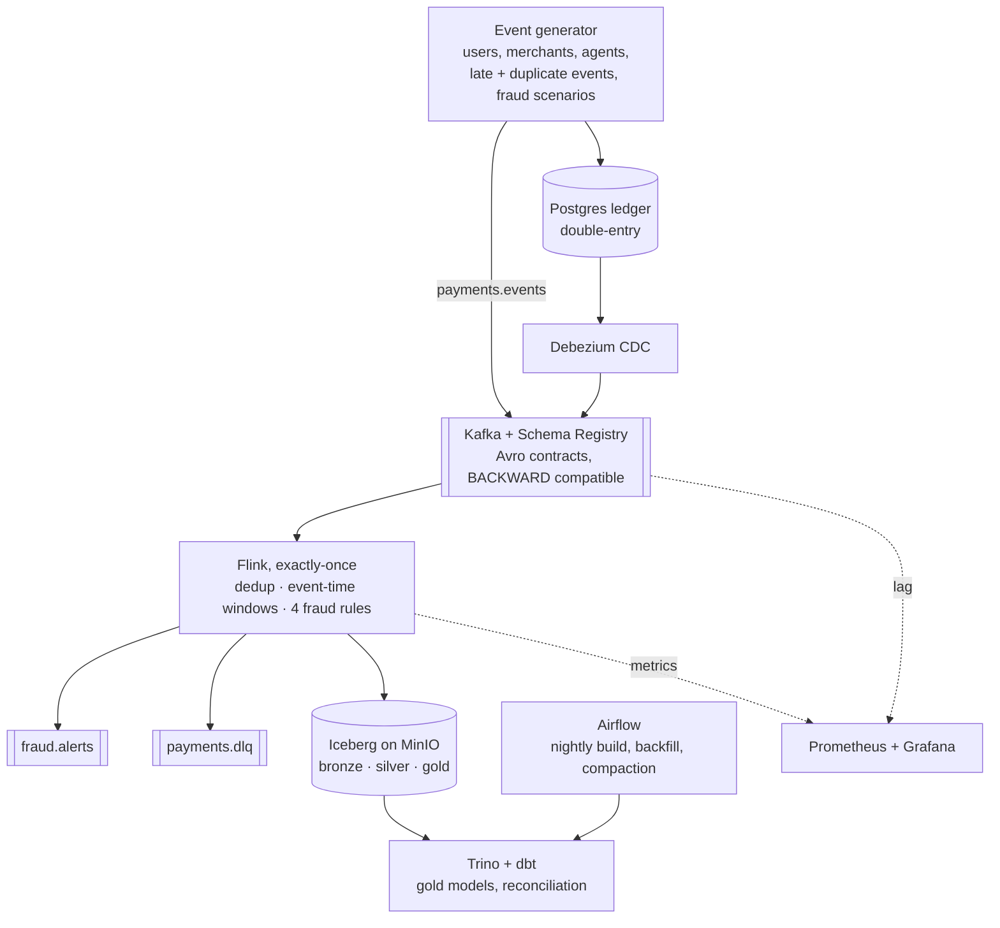

# PayStream

A real-time data platform for a mobile financial service (bKash-style payments: P2P transfers,
cash-in and cash-out at agents, merchant payments, airtime). It ingests payment events and ledger
changes, detects fraud within seconds, keeps an exactly-once lakehouse, and reconciles the stream
against the ledger to the paisa.

Everything runs on a laptop with Docker Compose.



## What it shows

| Problem | How PayStream handles it | Where |
| --- | --- | --- |
| Duplicates from app retries | Keyed dedup on `txn_id` with state TTL, then a second dedup in dbt for anything older | [`Dedup`](flink-jobs/src/main/java/io/paystream/flink/pipeline/Dedup.java), [`stg_payments`](dbt/models/staging/stg_payments.sql) |
| Late, out-of-order events | Event-time watermarks (10 s bound); late events still reach silver and are counted on the right day by the batch layer | [`PaymentsPipeline`](flink-jobs/src/main/java/io/paystream/flink/pipeline/PaymentsPipeline.java) |
| No loss, no double counting on failure | Flink checkpoints + Iceberg commit-on-checkpoint; verified by killing the TaskManager and broker mid-run | [`IcebergTables`](flink-jobs/src/main/java/io/paystream/flink/sink/IcebergTables.java), [`chaos.sh`](scripts/chaos.sh) |
| Schema changes | Avro in Schema Registry with BACKWARD compatibility; v1 producers keep working after v2 adds `channel` | [`schemas/`](schemas), [`SerdeTest`](flink-jobs/src/test/java/io/paystream/flink/serde/SerdeTest.java) |
| Bad records | Undecodable records go to a dead-letter topic with offset and error; the job keeps running | [`PaymentEventDeserializer`](flink-jobs/src/main/java/io/paystream/flink/serde/PaymentEventDeserializer.java) |
| Fraud in seconds | Four keyed rules fire on arrival, not on watermark: velocity, mule fan-in, new-device cash-out, agent float spike vs the agent's own baseline | [`rules/`](flink-jobs/src/main/java/io/paystream/flink/rules) |
| Money correctness | Integer paisa everywhere; double-entry ledger with a deferred balance check; daily stream vs ledger reconciliation | [`ledger/`](ledger/001_schema.sql), [`recon_stream_vs_ledger`](dbt/models/marts/recon_stream_vs_ledger.sql) |
| Reprocessing | Bronze keeps every record as received; Airflow rebuilds a day of silver from bronze, then gold | [`paystream_backfill`](airflow/dags/paystream_backfill.py) |
| Operating it | Grafana: throughput, consumer lag, alert latency, checkpoints, watermark lag | [`monitoring/`](monitoring) |

Design and tradeoffs: [docs/design.md](docs/design.md) and the [ADRs](docs/adr).

## Run it

Needs Docker with about 10 GB of memory for the stack, Java 17 and Python 3.11+ for tests.

```bash
make up          # starts the stack, creates topics, registers the CDC connector, submits both Flink jobs
make load        # 1,000 payments/s for 10 minutes into Kafka and the ledger
make sql         # Trino: SELECT * FROM silver.fraud_alerts ORDER BY detected_at DESC LIMIT 20;
make up-batch    # Airflow at http://localhost:8088 (nightly dbt build, backfill DAG)
make bench       # RATE=5000 DURATION=1800, writes benchmarks/runs/<time>.json
make bench CHAOS=1
make down
```

UIs: Flink http://localhost:8082 · Grafana http://localhost:3000 · MinIO http://localhost:9001.

## Tests

`make test` runs all of them; CI runs the same on every push.

* **Generator** (pytest): reproducibility, rate, late and duplicate injection, fraud scenario shape,
  Avro contract validity for v1 and v2, and that a v2 reader reads v1 data.
* **Flink** (JUnit, Flink test harness): each rule against real keyed state, timers and watermarks;
  dedup surviving a snapshot and restore; Avro decoding, schema evolution and DLQ routing; and an
  end-to-end run of the whole job graph into a real Iceberg catalog on local disk.
* **dbt** (DuckDB in CI, Trino in the stack): uniqueness, accepted values, positive amounts,
  double-entry balance, and closed-day reconciliation.

## Benchmarks

See [BENCHMARKS.md](BENCHMARKS.md). Numbers are reported only from real runs, with the machine they
ran on.

## Layout

```
generator/     Python traffic simulator (Kafka, JSONL, ledger sinks)
schemas/       Avro contracts; history/ holds earlier versions
flink-jobs/    Java: PaymentsJob (stream core) and LedgerCdcJob
ledger/        Postgres double-entry ledger schema
connect/       Debezium connector config
dbt/           staging + gold models on Trino; DuckDB target for CI
airflow/       nightly build and backfill DAGs
monitoring/    Prometheus scrape config, Grafana dashboard
benchmarks/    measure.py and run_benchmark.sh
docs/          design doc and ADRs
```
